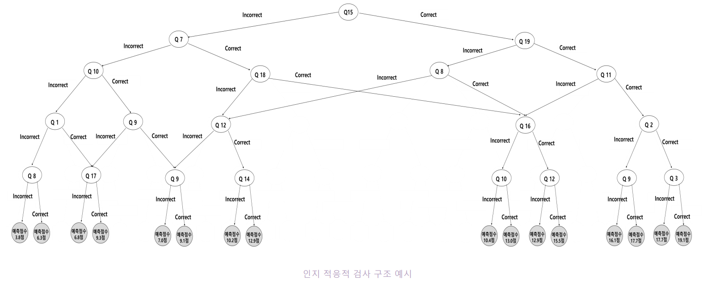

# ACT 적응적 인지능력검사: 병합 결정트리 구현

ACT(Adaptive Cognitive ability Test)는 문항의 정답·오답 반응에 따라 후속 문항을 선택하고, 적은 문항으로 기존 검사 총점을 예측하는 인지능력검사 프로젝트입니다. 이 저장소는 그중 R로 구현한 **Merged Decision Tree의 학습·예측·교차검증 핵심 함수**를 공개합니다. 보안상 실제 문항, 개별 응시자료, 영역별 최종 모형과 전체 상용 시스템은 포함하지 않습니다.

## 배경

제공된 데이터의 IRT 가정 충족에 제약이 있어 결정트리 기반 접근을 선택했고, 반복 분할로 노드별 학습 표본이 줄어드는 문제에 대응하기 위해 유사한 점수 분포를 가진 노드를 병합하는 방법을 적용했습니다. 알고리즘의 근거는 [Yan, Lewis와 Stocking의 연구](https://doi.org/10.3102/10769986029003293)입니다.

현재 코드는 `rpart` 기반 분할, t 통계량과 Cohen's d 기반 병합, 응답 경로에 따른 점수 예측, 외부 fold를 이용한 MAE 기준의 파라미터 탐색을 다룹니다. 

## 구조

```text
R/  
├─ config.R              분할 설정·패키지 및 입력 검증  
├─ merged_tree.R         학습·노드 병합·응답 경로 예측  
└─ cross_validation.R    외부 fold 기반 파라미터 탐색  
examples/  
├─ synthetic_data.R      실제자료와 무관한 합성자료 생성  
└─ synthetic_example.R   최소 실행 예제  
tests/regression.R       Git 기준 코드와의 동작 비교  
image/                   기존 선행연구·검사 구조 이미지
```

```text
score + 0/1 문항 반응 → 학습 → 분할·병합 노드  
↓  
응답 1행 → 경로·점수·단계  
외부 fold + 기준값 후보 → 학습·예측 반복 → fold별 MAE 평균 → 기준값 선택
```

## 참고 이미지

선행연구 초록과 기존 검사 구조 예시입니다. 현재 합성자료 실행 결과를 나타내는 이미지는 아닙니다.

<div align="center"></div>

 
