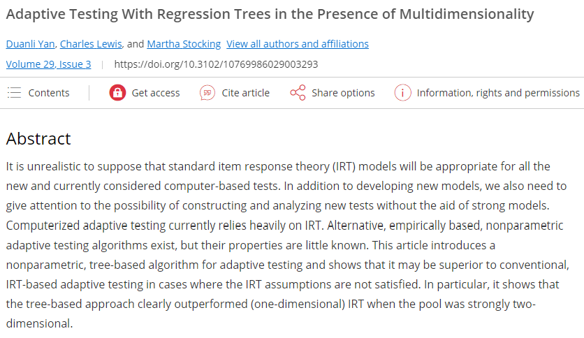

# ACT 적응적 인지능력검사: 병합 결정트리 구현

ACT(Adaptive Cognitive ability Test)는 문항의 정오 반응에 따라 후속 문항을 선택하고, 적은 문항으로 기존 검사 총점을 예측하는 인지능력검사 프로젝트입니다. 이 저장소는 그중 R로 구현한 **Merged Decision Tree의 학습·예측·교차검증 핵심 함수**를 공개합니다. 보안상 실제 문항, 개별 응시자료, 영역별 최종 모형과 전체 상용 시스템은 포함하지 않습니다.

## 배경과 담당 역할

제공된 자료의 IRT 가정 충족에 제약이 있어 결정트리 기반 접근을 선택했고, 반복 분할로 노드별 학습 표본이 줄어드는 문제에 대응하기 위해 유사한 점수 분포를 가진 노드를 병합하는 방법을 적용했습니다. 알고리즘의 근거는 [Yan, Lewis와 Stocking의 연구](https://doi.org/10.3102/10769986029003293)입니다.

본인은 데이터 전처리·분석, 검사 개발 방법 설계, Merged Decision Tree의 R 구현, 영역별 검사모형 개발·평가, 내부 도입과 기술 문서 작성을 담당했습니다. ORP연구소는 문항·응시 데이터 제공, 산출물 평가·일정 관리와 제품 제공·운영을 담당했습니다.

현재 코드는 `rpart` 기반 분할, t 통계량과 Cohen's d 기반 병합, 응답 경로에 따른 점수 예측, 외부 fold를 이용한 MAE 기준의 파라미터 탐색을 다룹니다. 과거 프로젝트의 다른 비교 모형이나 전체 검사 운영 기능을 구현한 것으로 해석하지 않습니다. 합성자료 예제는 사용법과 코드 검증용이며 과거 성능을 재현한 자료가 아닙니다.

## 구조

```text
R/
├─ config.R              분할 설정·패키지 및 입력 검증
├─ merged_tree.R         학습·노드 병합·응답 경로 예측
└─ cross_validation.R    외부 fold 기반 파라미터 탐색
examples/
├─ synthetic_data.R      실제자료와 무관한 합성자료 생성
└─ synthetic_example.R   최소 실행 예제
tests/regression.R       Git 기준 코드와의 동작 비교
docs/validation.md       검증 조건·결과·한계
image/                   기존 선행연구·검사 구조 이미지
```

```text
score + 0/1 문항 반응 → 학습 → 분할·병합 노드
                                  ↓
                         응답 1행 → 경로·점수·단계
외부 fold + 기준값 후보 → 학습·예측 반복 → fold별 MAE 평균 → 기준값 선택
```

## 참고 이미지

선행연구 초록과 기존 검사 구조 예시입니다. 현재 합성자료 실행 결과를 나타내는 이미지는 아닙니다.

<div align="center">
  
  
</div>
